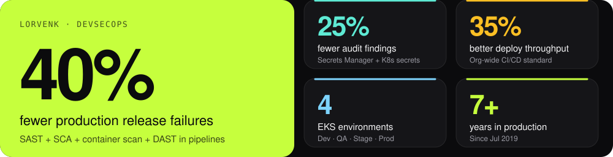
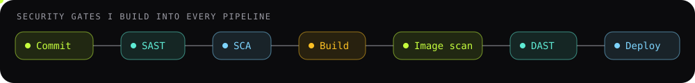

  

  
  
  
  

  Remote and hybrid roles · US / Canada · Based in Hyderabad, India · Worked US hours with a US team

### Impact

  

### How I work: security gates in every pipeline

  

### Now

**Project Lead, DevOps & Platform at EasyCloud.** Sole owner of infrastructure, deployments and operations for a self-hosted Frappe/ERPNext CRM (Docker Compose on Hetzner), with a Faster-Whisper transcription microservice and idempotent workflow automation.

### Proof, in code

| Repo | What it shows |
|---|---|
| [**vprofile-devops**](https://github.com/mohammedinzi/vprofile-devops) | Three-tier app from Vagrant to AWS, Terraform, GitHub Actions |
| [**insured-assurances**](https://github.com/mohammedinzi/insured-assurances) | GitHub Actions to S3 presigned URL to Jenkins to Tomcat, with smoke test |
| [**easycloud_automations**](https://github.com/mohammedinzi/easycloud_automations) | Backup-first installs onto live Frappe benches; idempotent automations |
| [**claude-kit**](https://github.com/mohammedinzi/claude-kit) | Per-project provisioning for Claude Code |
| [**rootchat**](https://github.com/mohammedinzi/rootchat) | Real-time terminal chat on Node.js and Socket.IO |

### Toolbox

  

  
  
  
  
  
  

### Education

MS Computer and Information Systems Security, Rowan University · B.Tech Information Technology, JNTU

Daily ops log: <a href="https://github.com/mohammedinzi/worklog">worklog</a> · Videos: <a href="https://youtube.com/@InziDevSecOps">YouTube</a>

